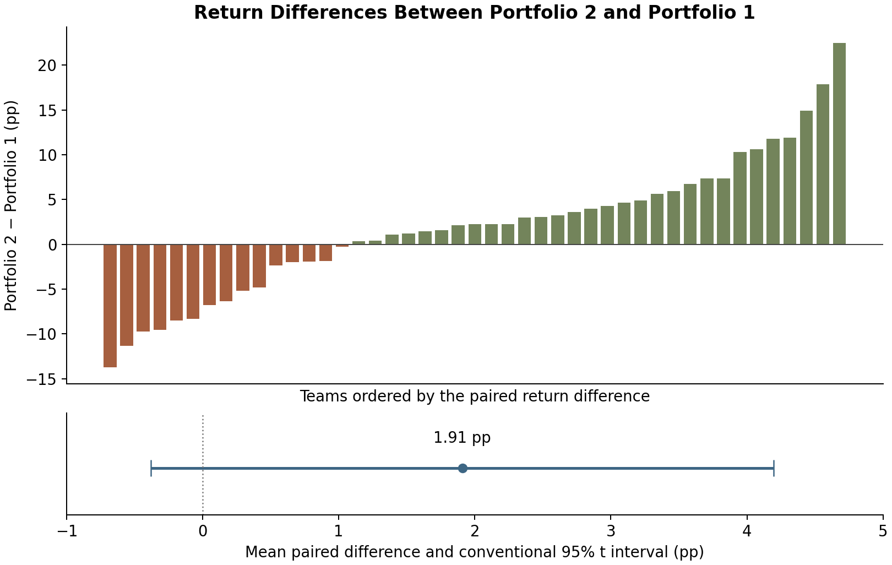
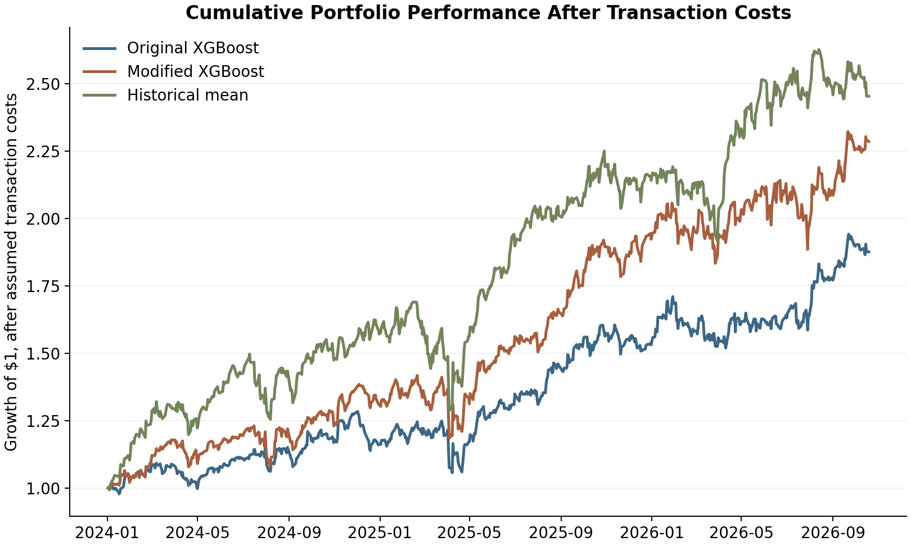

A forecast is useful to investors only if the decisions it supports improve investment outcomes. Our classroom experiment compared portfolios chosen by intuition with portfolios guided by financial analysis. Using the observed return differences as motivation, I now test whether modifying XGBoost improves forecasts and investment returns under identical trading rules.

{fig-alt="Three trays of stock certificates with candlestick charts, forecasting notebooks, a calendar and coins on a desk beside a golden retriever."}

## What did the classroom experiment show?

Each team started two portfolios with **$100,000** for roughly two months. Portfolio 1 used intuition; Portfolio 2 used financial analysis to select stocks and set portfolio weights, including an option based on XGBoost return forecasts.

**Analysis-assisted portfolios earned more on average, but the advantage was imprecisely estimated.** Across 45 teams, average returns were **1.18% versus 3.09%**. Portfolio 2 won in 30 pairs. The mean within-team advantage was **1.91 percentage points**, with a conventional paired-test 95% interval of **−0.38 to 4.20 points** and a two-sided p-value of **0.100**.

{#fig-classroom fig-alt="Thirty of 45 paired return differences are positive; the confidence interval for the mean crosses zero."}

The wide dispersion makes a short-run average difficult to interpret. Shared holdings could also make teams' outcomes dependent. More generally, unexpected news and changing relationships between historical signals and future returns make prediction difficult; final balances cannot identify which mechanism drove these differences.

The classroom portfolios remain unchanged observations. The following exercise separately reruns the original model, a modified model and a simple benchmark under identical trading rules.

## How did I modify the model?

**The modification aimed to reduce overfitting and remove price-scale information.** The original specification combines prices, trading volume and return-based signals in 300 boosted trees, each up to five levels deep. Boosting sequentially fits trees to improve earlier predictions.

I retained the classroom's **95-stock universe**, downloading daily Yahoo Finance data from January 2022 through November 2026. Python constructs features, fits XGBoost and tracks portfolio wealth. Adjusted prices supply consistent return measures; SPY supplies market-relative features only.

The modified model uses conventional momentum, volatility and market-relative returns rather than raw price levels. Two chronological validation windows in 2023 selected **150 trees, depth 2 and a 0.03 learning rate** from eight configurations, with stronger regularization.

All three methods use the same pre-2024 training observations and remain frozen during testing. Each predicts the return from the next trading day's close to 20 sessions later. The simple benchmark predicts each stock's **own historical average return** over that horizon.

## Are the forecasts better?

**The modified model reduced numerical prediction error, but did not improve the overall ranking.** Table 1 evaluates 3,325 forecasts across 35 common test dates. RMSE measures forecast error in percentage points; lower is better. Rank correlation measures how well predicted stock rankings match realized rankings, averaged across dates; higher is better.



RMSE fell from **9.91 to 9.41 points**, only slightly below the historical mean's **9.43**. Meanwhile, rank correlation declined from **0.037 to 0.030**. More accurate return magnitudes therefore did not imply better ordering across all stocks.

## Did the difference matter for investors?

**The modified strategy beat the original, but the historical-mean benchmark earned the highest net return.** Every strategy starts with $100,000, buys its ten highest-ranked stocks at equal weights at the next close, and rebalances every 20 trading days. No strategy uses leverage, market timing or stop-loss rules. Weights drift between rebalances.

The common completed investment period is **January 3, 2024–October 19, 2026**. Net results deduct an assumed **0.1% of every dollar bought or sold**, including entry and liquidation. Maximum drawdown measures the largest daily peak-to-trough wealth decline.

{#fig-growth fig-alt="The modified model finishes above the original model but below the historical-mean strategy after transaction costs."}



The modified model earned **128.6% net**, versus **87.6%** for the original and **145.3%** for the benchmark. It also had the smallest drawdown: **16.4%**, versus **17.7%** and **23.8%**.

The benchmark repeatedly holds the same ten stocks, requiring little trading beyond restoring equal weights. The modified model trades much more. Costs reduce its cumulative return by **12.2 percentage points**, compared with **1.1 points** for the benchmark. At a doubled 0.2% fee, the return ordering remains unchanged.

**Why can a less accurate benchmark earn more?** Our prediction scores evaluate all 95 stocks, but our portfolio holds only the ten with the highest forecasts. A model can make smaller errors overall without choosing a more profitable top ten. Improving the order of stocks near the bottom, for example, improves the ranking score without changing our holdings. The benefit of a forecast therefore depends partly on the investment rule used to act on it.

The size and consistency of the prediction advantage also matter. The modified model’s RMSE was only slightly lower than the benchmark’s—**9.41 versus 9.43 percentage points**—and both ranking correlations were close to zero. We have not established that these small differences represent a reliable advantage. Unexpected news and changing market conditions can also affect realized returns, so performance in this particular test period may partly reflect chance. Our results do not isolate those effects.

What we can verify is that the benchmark’s selected stocks earned **2.85% per holding period on average**, versus **2.65%** for the modified model. Their returns compounded into a higher gross return, and lower trading costs widened the benchmark’s cumulative advantage from **5.6 to 16.8 percentage points**. **Investment value depends on how forecasts become holdings, how those holdings actually perform, and what trading costs—not on prediction scores alone.**

## Takeaway

**The modified model improved on the original, but its small prediction-score advantage over the historical-mean benchmark did not deliver higher net returns.** Overall accuracy does not guarantee better top-ten selections, and a small advantage may not persist across market conditions. In this test, the benchmark’s holdings earned more and required less trading, while the modified model had a smaller drawdown. **The investment value of a forecast depends on portfolio construction, realized returns and costs, as well as whether its predictive advantage is reliable.**

::: {.source-note}
**Sources and replication.** Data: Fall 2026 classroom portfolio results and [Yahoo Finance](https://finance.yahoo.com/). See the [GitHub repository](https://github.com/xia071212/blog9repo) and [README](README.md) for data sources, methods and replication instructions, or [download the code and results](replication.zip).
:::
